# AlpineOS — Ski Resort Management System

[](https://github.com/fathylmaz/alpineos-ski-resort-management/actions/workflows/ci.yml)
[](LICENSE)

**🌐 Language / Dil:** [🇹🇷 Türkçe](README.md) · **🇬🇧 English**

**A full-stack ski resort management application with connected administrator and customer portals, built around a relational database.**

I redesigned my university Ski Resort Automation project as **AlpineOS**, retaining its central business idea while moving the system to a modern web application. Equipment rentals, accommodation, ski slopes, lessons and events, employees, and financial records are managed together.

The **administrator portal and customer portal share the same ASP.NET Core API and PostgreSQL database**. Reservations created by customers therefore appear in the operational records managed by staff.

> **Scope:** AlpineOS is an educational and portfolio project that has been run locally with Docker. Sample data is fictional. Real card processing, a production payment gateway, and production compliance are outside its scope.

## At a glance

| Administrator dashboard | Customer home |
|:--:|:--:|
| 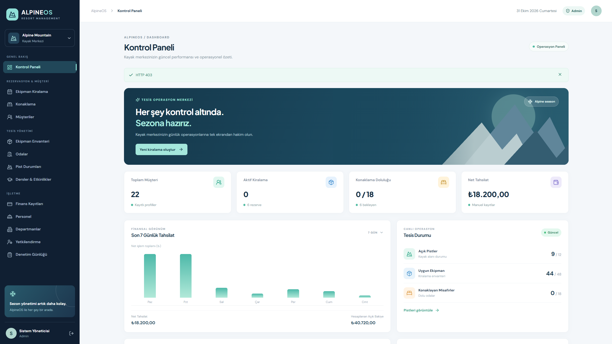 | 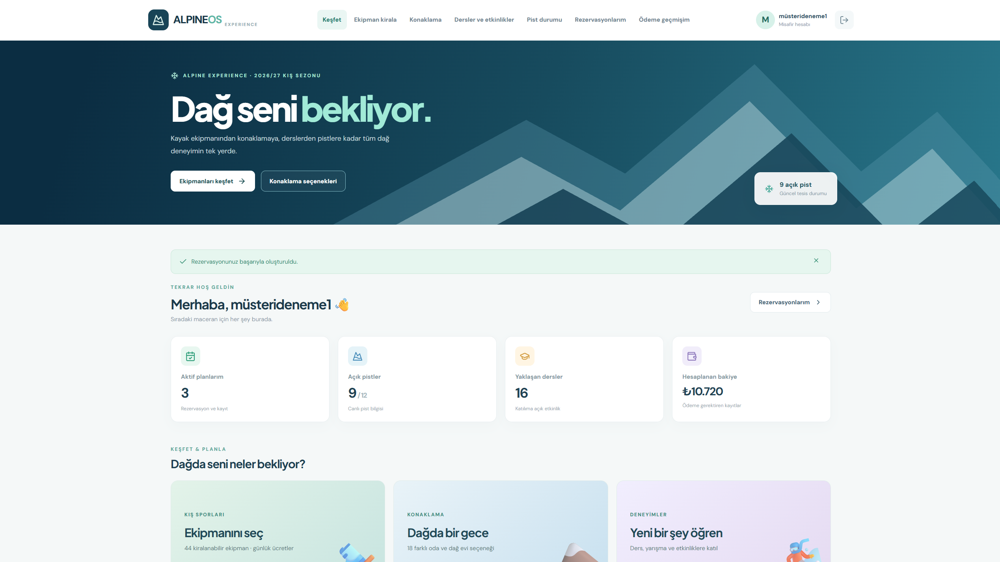 |
| Resort operations, bookings and KPIs | Rentals, accommodation, lessons and personal bookings |

**Contents:** [Features](#features) · [Screenshots](#application-screenshots) · [Tech stack](#tech-stack) · [Architecture](#system-architecture) · [Setup](#setup) · [Tests](#tests-and-quality) · [Documents](#project-documentation)

---

## Features

### Administrator portal

| Module | Implemented features |
|---|---|
| **Dashboard** | KPIs, operational summaries, financial information and charts |
| **Customers** | Create, view and edit customer records |
| **Equipment inventory** | Ski, snowboard, boot and helmet assets; prices, availability and maintenance |
| **Rentals** | Date-based bookings, handover, return, cancellations and history |
| **Accommodation** | Rooms and cabins, occupancy, bookings, check-in/out and cancellation |
| **Slopes** | Difficulty level, open/closed state, snow depth and weather details |
| **Lessons and events** | Instructors, schedules, capacity and enrollment |
| **Finance** | Manually recorded payments and refunds; no real payment processing |
| **Staff and departments** | Employee and department records, accounts and role-based access |
| **Reporting** | Operational views, CSV export and audit events |

### Customer portal

- **Accounts:** Sign up and sign in with email and password; edit profile details.
- **Explore:** Browse resort services from a single entry point.
- **Equipment catalog:** View categories, sizes, prices and rentable assets.
- **Equipment booking:** Choose dates, check availability, see estimated pricing and submit reservations.
- **Accommodation:** Browse rooms and cabins; reserve against capacity and dates.
- **Lessons and events:** Browse instructors, prices and remaining places; enroll in sessions.
- **Slopes:** Check operational status, difficulty and snow information.
- **My bookings:** View own rentals, stays and activity enrollment; cancel when allowed.
- **Payment history:** View manual payment and refund entries associated with the customer.
- **Profile:** Edit name and contact number.

Customer-owned records are resolved from the authenticated session rather than a customer ID supplied by the browser. Administrator functions are protected by separate role policies.

### Demo data

With `SEED_DEMO_DATA=true`, development instances can populate fictional sample records:

| Dataset | Sample records |
|---|---:|
| Equipment | 48 |
| Accommodation units | 18 |
| Departments | 9 |
| Staff | 16 |
| Customers | 18 |
| Slopes | 12 |
| Lessons and events | 16 |

The demo also includes maintenance, reservation, enrollment and payment records. Demo customer records are not automatically usable login accounts; create a customer account to explore the portal. The seeder aims to add missing records without deleting existing data.

---

## Application screenshots

These **16 screenshots are from the running application**, with the files stored in `docs/screenshots/`.

### Administrator interface

| Login | Equipment inventory |
|:--:|:--:|
| 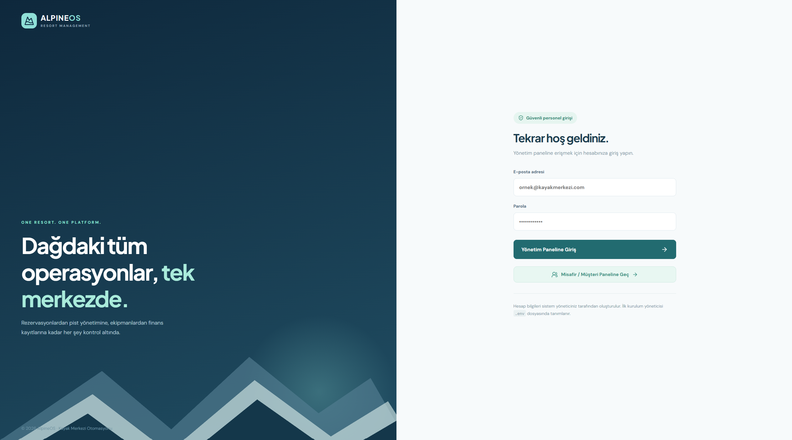 | 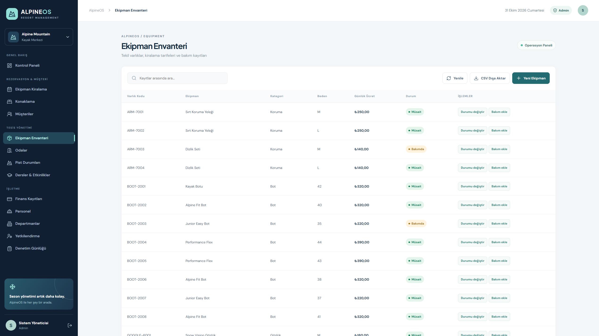 |
| **01.** Staff authentication | **03.** Asset categories and stock |

| Rental management | Accommodation |
|:--:|:--:|
| 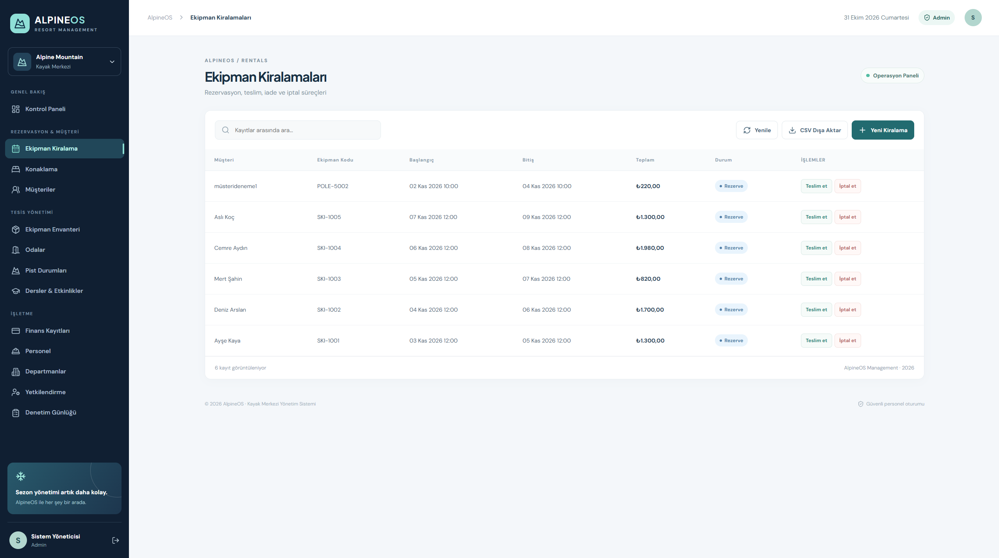 | 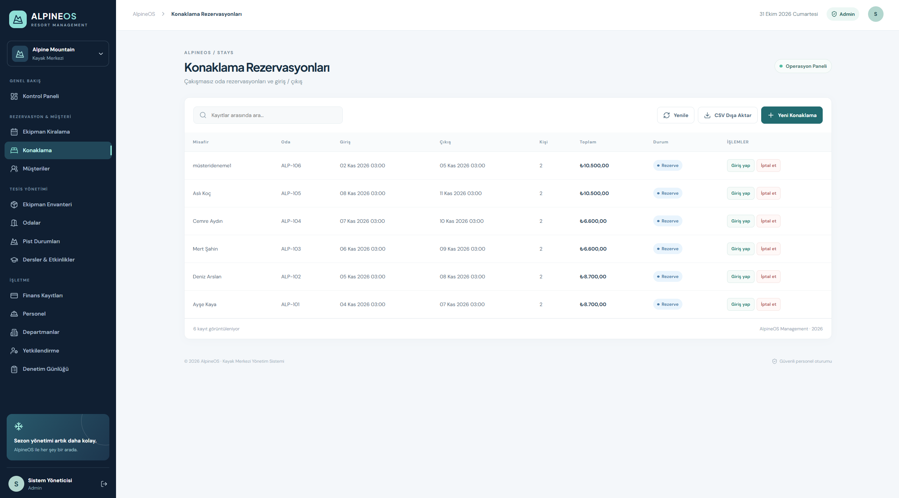 |
| **04.** Rental records and statuses | **05.** Rooms and reservations |

| Slopes | Lessons and events |
|:--:|:--:|
| 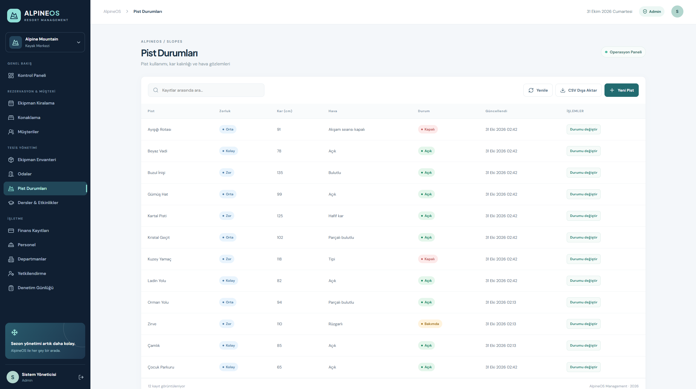 | 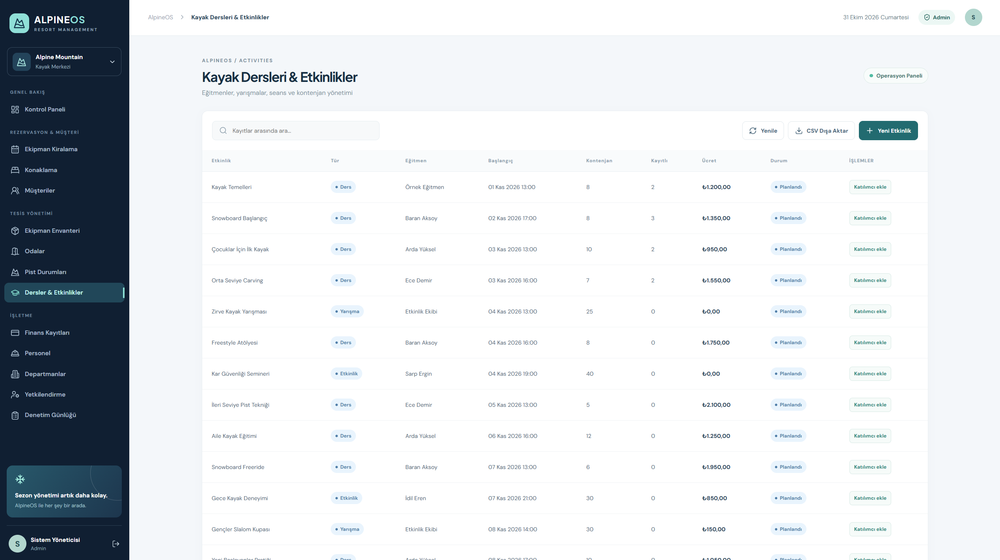 |
| **06.** Snow and piste status | **07.** Sessions, instructors and capacity |

| Finance | Departments and staff |
|:--:|:--:|
| 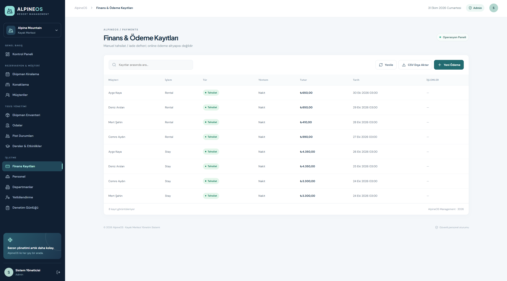 | 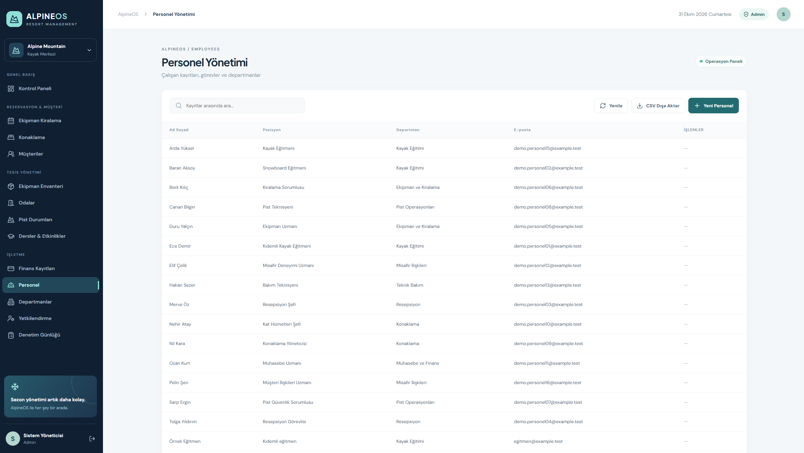 |
| **08.** Manually recorded transactions | **09.** Organizational records |

**02. Administrator dashboard** appears in the preview at the beginning of this README.

### Customer interface

| Customer login | Equipment catalog |
|:--:|:--:|
| 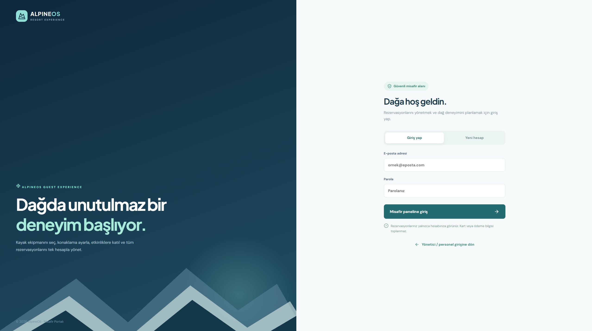 | 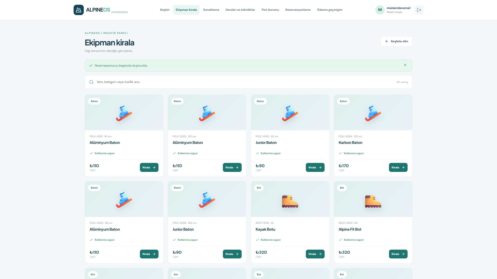 |
| **10.** Customer authentication | **12.** Rentable equipment and rates |

| Booking form | Accommodation options |
|:--:|:--:|
| 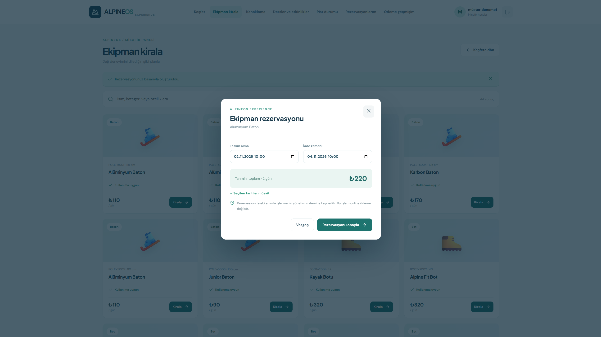 | 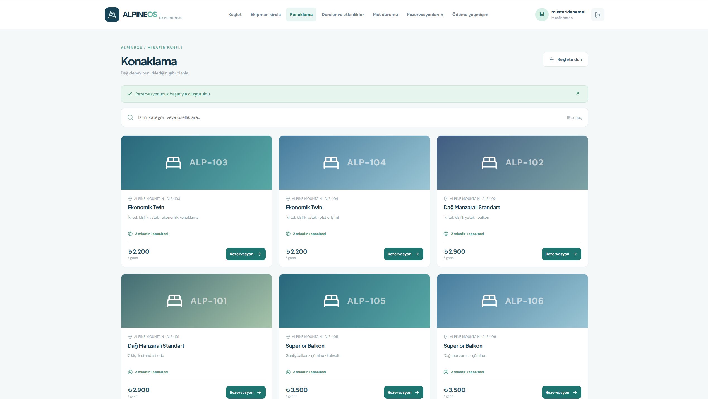 |
| **13.** Dates, availability and estimated total | **14.** Room and cabin options |

| My bookings | Mobile layout |
|:--:|:--:|
| 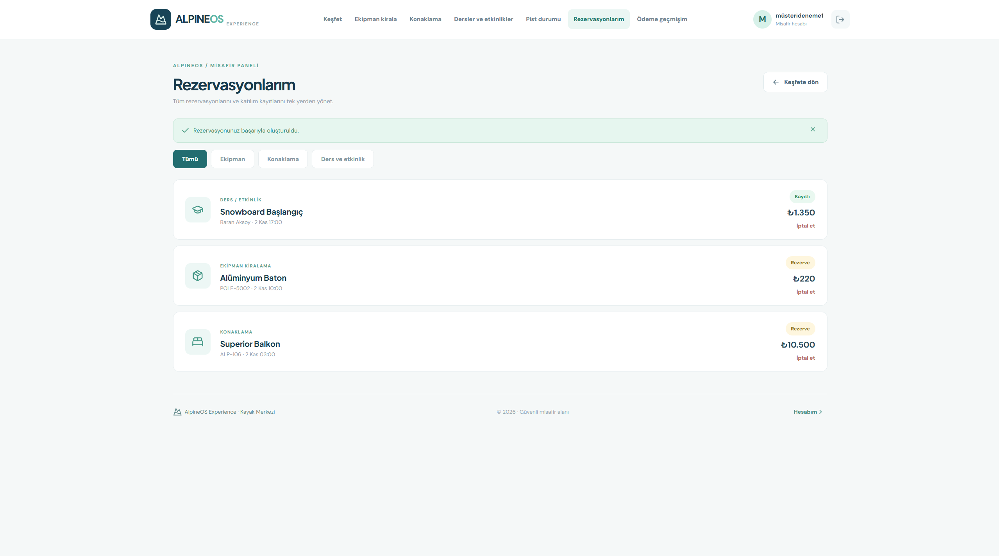 | 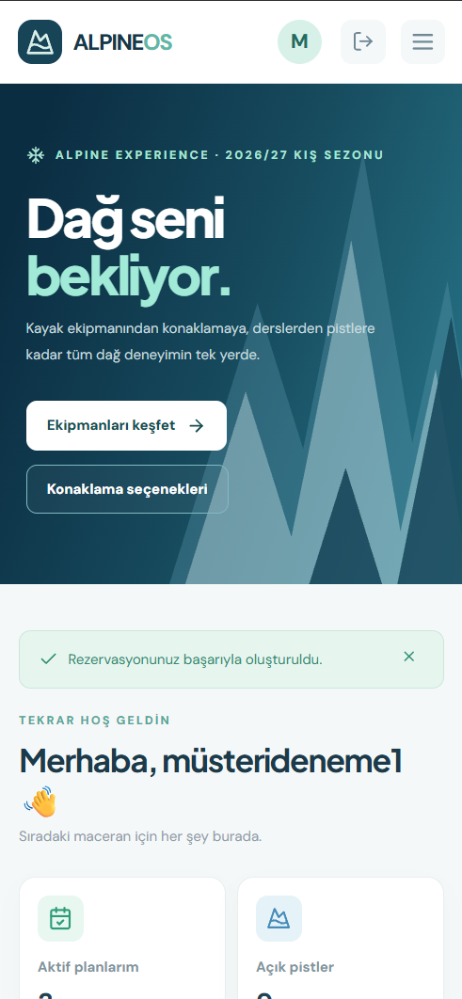 |
| **15.** Rental, stay and activity history | **16.** Responsive customer experience |

**11. Customer home** is shown in the opening preview. All screenshots numbered **01–16** are included.

---

## Tech stack

| Layer | Technology | Role |
|---|---|---|
| Backend | **C# · ASP.NET Core 10 Minimal API** | HTTP endpoints and business operations |
| Data access | **Entity Framework Core · Npgsql** | Relational mapping and database operations |
| Database | **PostgreSQL 17** | Customer, asset, booking and operational records |
| Frontend | **React 19 · TypeScript · Vite** | Administrator and customer experiences |
| UI | **CSS · Lucide Icons** | Responsive layout and visual elements |
| Authentication | **ASP.NET Cookie Authentication · PasswordHasher · Antiforgery** | Sessions, credentials and request protection |
| Deployment | **Docker · Docker Compose · Nginx** | Local containerized application |
| Testing / CI | **xUnit · Python test scripts · GitHub Actions** | Business rules, API checks and builds |

## System architecture

The React frontend provides two role-specific experiences. Requests pass through Nginx to the ASP.NET Core API, which applies authentication, authorization and business rules before persisting data to PostgreSQL.

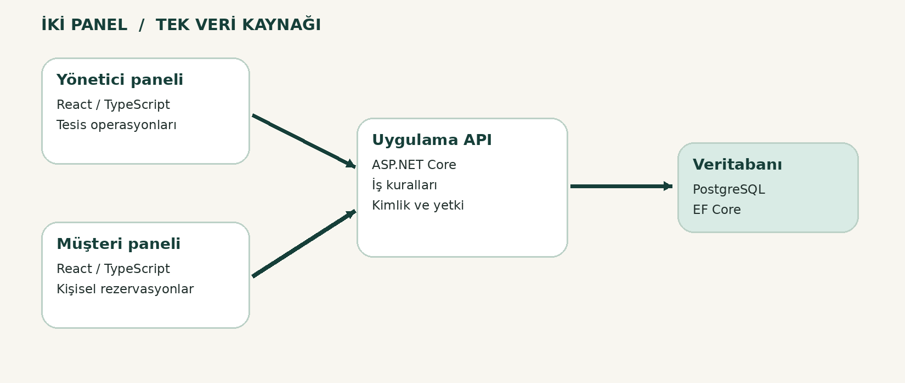

### Relational data model

Customers, employees, equipment, rentals, rooms, stays, slopes, events and payments use related database entities.

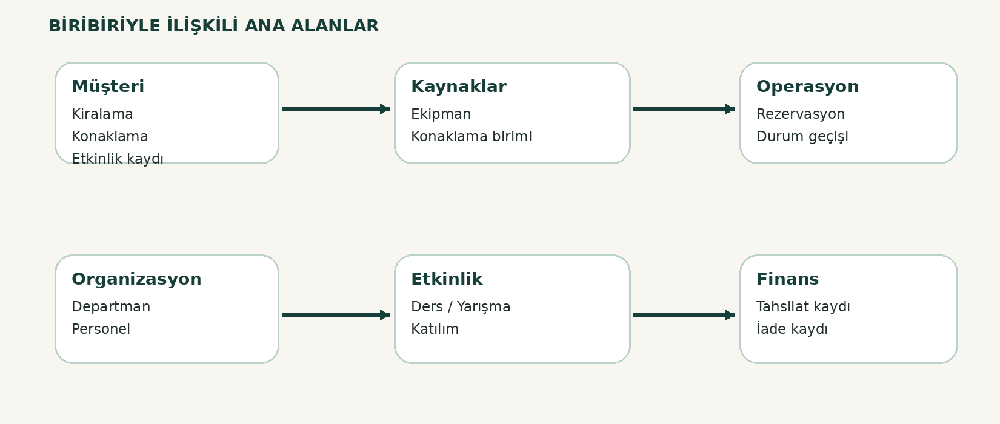

### Reservation workflow

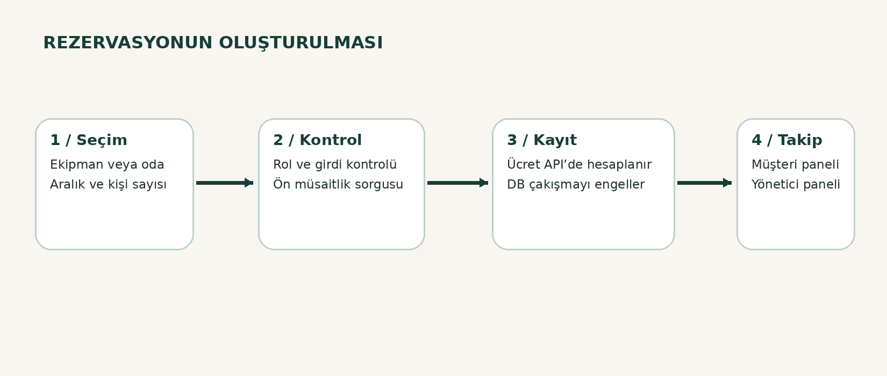

- Availability is displayed before making a reservation.
- Server-side business rules re-check submitted requests.
- PostgreSQL constraints help prevent overlapping room and equipment bookings.
- Room occupancy and session capacity are checked in the API.
- Customer reservations and administrative records share one database.

See the [architecture notes](docs/architecture.md) and [technical report](docs/reports/02_Teknik_Mimari_Veri_Modeli.pdf).

---

## Setup

### Requirements

- **Docker Desktop** and Docker Compose
- **Git**, if cloning the repository
- Optional for independent development: **.NET 10 SDK**, **Node.js 22+** and npm

### Run with Docker

From the repository root in PowerShell:

```powershell
Copy-Item .env.example .env
code .env
```

Set `POSTGRES_PASSWORD`, `ADMIN_PASSWORD` and `ADMIN_EMAIL` in the local `.env` file. Use different strong passwords of at least 12 characters. **Do not commit your real `.env` file.**

```powershell
docker compose up -d --build
docker compose ps
```

Open **http://localhost:8088**.

- **Administrator:** Log in with `ADMIN_EMAIL` and `ADMIN_PASSWORD` from `.env`.
- **Customer:** Select **Guest / Customer Portal**, then create a customer account with a password of at least 12 characters.
- Set `SEED_DEMO_DATA=true` only in local demo/development environments.

To stop containers without removing the database volume:

```powershell
docker compose down
```

**Avoid `docker compose down -v` when you need to preserve existing database records.**

### Run components separately

With PostgreSQL configured and environment variables such as `ConnectionStrings__Resort`, `ADMIN_EMAIL` and `ADMIN_PASSWORD` set:

```powershell
cd api
dotnet restore
dotnet run --launch-profile http
```

In another terminal:

```powershell
cd web
npm install
npm run dev
```

The usual local Vite URL is `http://localhost:5173`; the local API launch profile uses `http://localhost:5107`.

## Repository layout

```text
SkiResort-Management/
├── api/                 ASP.NET Core API and business logic
├── web/                 React admin and customer portals
├── tests/               .NET business rule tests
├── scripts/             Setup, backup and API check scripts
├── docs/
│   ├── screenshots/     16 real application screenshots
│   ├── diagrams/        Architecture, data model and booking flow
│   ├── reports/         PDF reports and presentation
│   ├── architecture.md
│   ├── api-reference.md
│   ├── customer-portal.md
│   └── testing.md
├── compose.yaml
├── .env.example
├── README.md            Turkish
├── README.en.md         English
├── SECURITY.md
└── LICENSE
```

## Tests and quality

The application has been launched locally with Docker. The **GitHub Actions CI pipeline on `main` has also passed** backend restore/build, xUnit tests, frontend TypeScript/build, and README image/document checks. The badge at the top shows the latest result for the main branch.

This does not imply complete end-to-end, performance, security or production testing.

```powershell
dotnet test tests/SkiResort.Tests/SkiResort.Tests.csproj

cd web
npm install
npm run build
cd ..

docker compose ps
```

For API and scenario testing, read [testing](docs/testing.md) and [quality notes](docs/reports/04_Test_Kalite_Notlari.pdf).

### Security and limitations

- Staff and customer accounts have separate role-based permissions.
- Passwords are hashed and sessions use HttpOnly cookies.
- CSRF protection applies to state-changing requests.
- Customers can access their own data through session-derived identity.
- **No real credit card or online payment transactions are processed.**
- Database initialization currently uses `EnsureCreatedAsync()` instead of a managed production migration strategy.
- Public production deployment would require HTTPS, expanded authorization testing, KVKK/GDPR planning, backups, restore verification, and additional security reviews.

See [SECURITY.md](SECURITY.md) and [operations](docs/operations.md).

---

## Project documentation

| Document | Description |
|---|---|
| [Academic project report](docs/reports/01_Proje_Raporu.pdf) | Problem, purpose, scope and implementation |
| [Architecture and data model](docs/reports/02_Teknik_Mimari_Veri_Modeli.pdf) | Layers, relationships, database and workflows |
| [Administrator and customer guide](docs/reports/03_Kullanim_Kilavuzu.pdf) | Key user flows for both portals |
| [Testing and quality notes](docs/reports/04_Test_Kalite_Notlari.pdf) | Validation status, constraints and suggested improvements |
| [Screenshot guide](docs/reports/05_Ekran_Goruntusu_Rehberi.pdf) | UI presentation guidance |
| [Project presentation](docs/reports/06_Proje_Sunumu.pdf) | System overview, modules and diagrams |
| [API reference](docs/api-reference.md) | HTTP endpoint descriptions |
| [Customer portal documentation](docs/customer-portal.md) | Customer access and shared backend |

## Connection to my university project

AlpineOS evolved from the **Ski Resort Automation** project I worked on at university. I preserved the domain and core database-oriented business processes, but rebuilt the solution as a modern full-stack application. It is **a new implementation and extension**, not a direct copy of the original code.

The project helped me explore relational database design, API/UI integration, role-based access, booking constraints and Docker deployment.

---

**License:** MIT — [LICENSE](LICENSE)

**🌐 Switch language:** [🇹🇷 Türkçe](README.md) · **🇬🇧 English**
