# AlpineOS — Kayak Merkezi Otomasyonu

**Kayak merkezi operasyonlarını yönetici ve müşteri panellerinde bir araya getiren, veritabanı odaklı bir full-stack web uygulaması.**

Üniversitede üzerinde çalıştığım **Kayak Merkezi Otomasyonu** projesinin ana fikrini koruyarak AlpineOS adıyla yeniden geliştirdim. Orijinal çalışma, kayak merkezi işlemlerinin veritabanı üzerinden düzenlenmesine odaklanıyordu. Bu sürümde aynı senaryoyu web tabanlı bir sisteme taşıyarak ekipman kiralama, konaklama, pist yönetimi, kayak dersleri, personel işlemleri ve finans kayıtlarını tek bir uygulamada topladım.

AlpineOS'ta **yönetici ve müşteri arayüzleri aynı ASP.NET Core API'sini ve PostgreSQL veritabanını kullanır.** Böylece müşterinin oluşturduğu rezervasyon, personelin yönettiği operasyonel kayıtlara yansır.

> **Proje kapsamı:** Eğitim ve portföy amaçlı, yerel ortamda Docker ile çalıştırılmış bir uygulamadır. Demo verileri kurgusaldır. Gerçek kart tahsilatı, çevrimiçi ödeme altyapısı ve üretim ortamı gereksinimleri bu çalışmanın kapsamı dışındadır.

## Uygulamaya ilk bakış

| Yönetici kontrol paneli | Müşteri keşfet paneli |
|:--:|:--:|
| 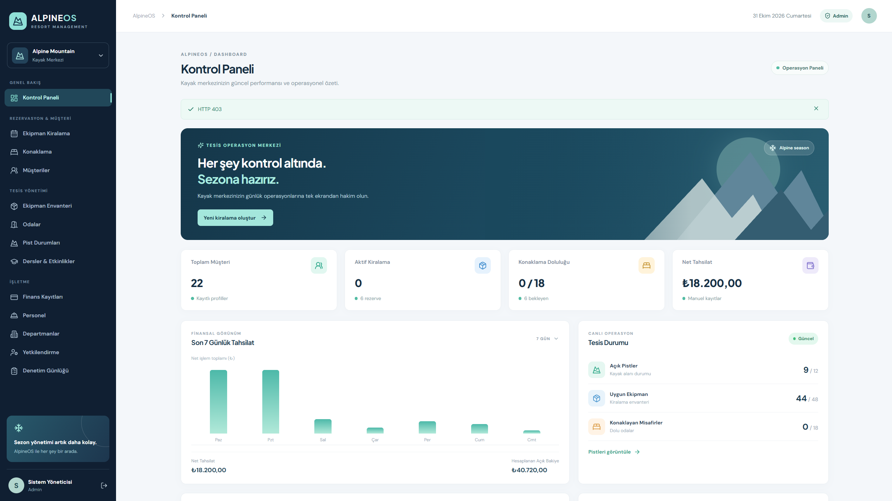 | 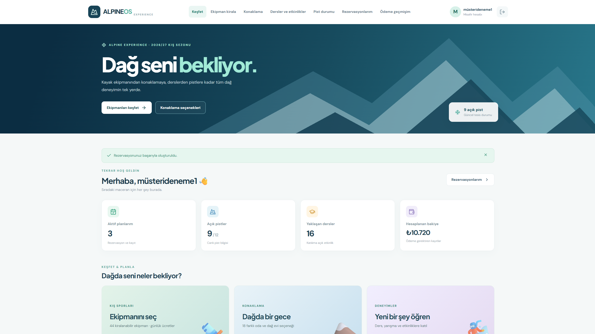 |
| İşletmenin günlük süreçleri, rezervasyonları ve operasyonel verileri | Ekipman, konaklama, dersler ve kişisel rezervasyonlara erişim |

**İçindekiler:** [Özellikler](#özellikler) · [Ekran görüntüleri](#uygulama-ekran-görüntüleri) · [Teknolojiler](#teknolojiler) · [Mimari](#sistem-mimarisi) · [Kurulum](#kurulum) · [Test](#test-ve-kalite-kontrolleri) · [Dokümanlar](#proje-dokümanları)

---

## Özellikler

### Yönetici paneli

| Modül | Uyguladığım işlevler |
|---|---|
| **Kontrol paneli** | Temel istatistikler, operasyon özeti, finans verileri ve grafikler |
| **Müşteri yönetimi** | Müşteri kayıtlarının eklenmesi, görüntülenmesi ve düzenlenmesi |
| **Ekipman envanteri** | Kayak, snowboard, bot, kask ve diğer demirbaşlar; fiyat, durum ve bakım kayıtları |
| **Kiralama işlemleri** | Tarih aralığıyla rezervasyon, teslim, iade, iptal ve kayıt geçmişi |
| **Konaklama** | Oda/dağ evi tanımlama, kapasite, rezervasyon, giriş-çıkış ve iptal |
| **Pist yönetimi** | Pist zorluğu, açık/kapalı durumu, kar kalınlığı ve hava bilgileri |
| **Dersler ve etkinlikler** | Eğitmen, seans, kontenjan ve müşteri katılım kayıtları |
| **Finans kayıtları** | Manuel tahsilat ve iade hareketleri; gerçek ödeme alınmaz |
| **Personel ve departmanlar** | Personel kayıtları, departmanlar, hesaplar ve rol temelli yetkiler |
| **Raporlama** | Kayıt ve özet ekranları, CSV dışa aktarma, işlem denetimi |

### Müşteri paneli

- **Müşteri hesabı:** E-posta ve parola ile kayıt, giriş, çıkış ve profil düzenleme.
- **Keşfet:** Kayak merkezinin sunduğu hizmetlere tek ekrandan erişim.
- **Ekipman kataloğu:** Kullanılabilir ürünlerin kategorilerini, ölçülerini ve günlük ücretlerini inceleme.
- **Ekipman rezervasyonu:** Tarih seçimi, müsaitlik sorgulama, tahmini tutar ve rezervasyon oluşturma.
- **Konaklama:** Oda ve dağ evlerini görüntüleme; kapasiteye göre tarihli rezervasyon.
- **Kayak dersleri ve etkinlikler:** Programı, eğitmeni, ücreti ve kalan kontenjanı inceleme; katılım kaydı oluşturma.
- **Pist durumu:** Açık/kapalı pistleri, zorluk seviyelerini ve tesis bilgilerini görme.
- **Rezervasyonlarım:** Kendi kiralama, konaklama ve etkinlik kayıtlarını tek listede görüntüleme; uygun durumlarda iptal.
- **Ödeme geçmişim:** İşletme tarafından girilmiş kendi tahsilat ve iade hareketlerini görüntüleme.
- **Profilim:** Ad-soyad ve telefon bilgilerini düzenleme.

Müşteri portalında kullanıcıya ait kayıtlar, istemcinin gönderdiği bir müşteri kimliğine göre değil, **oturumdaki kimliğe** göre sorgulanır. Yönetici işlemleri ise ayrı rol politikalarıyla korunur.

### Zenginleştirilmiş demo verileri

`SEED_DEMO_DATA=true` seçeneğiyle geliştirme ortamında örnek işletme kayıtları oluşturulur:

| Veri grubu | Örnek kayıt sayısı |
|---|---:|
| Ekipman | 48 |
| Konaklama birimi | 18 |
| Departman | 9 |
| Personel | 16 |
| Müşteri | 18 |
| Pist | 12 |
| Ders ve etkinlik | 16 |

Bunlara ek olarak bakım, rezervasyon, katılım ve finans hareketlerinden oluşan kurgusal örnekler bulunur. **Demo müşterileri otomatik giriş yapılabilen hesaplar değildir; müşteri panelini denemek için yeni bir hesap oluşturulabilir.** Başlangıç verileri mevcut kayıtları topluca silmek yerine eksik örnekleri eklemeyi hedefler.

---

## Uygulama ekran görüntüleri

Aşağıdaki galeri, çalışan uygulamadan çektiğim **16 ayrı ekranı** göstermek için düzenlenmiştir. Görseller GitHub’da görünebilmek için depodaki `docs/screenshots/` klasörüne burada belirtilen dosya adlarıyla eklenmelidir.

### Yönetici arayüzü

| Giriş ekranı | Ekipman envanteri |
|:--:|:--:|
| 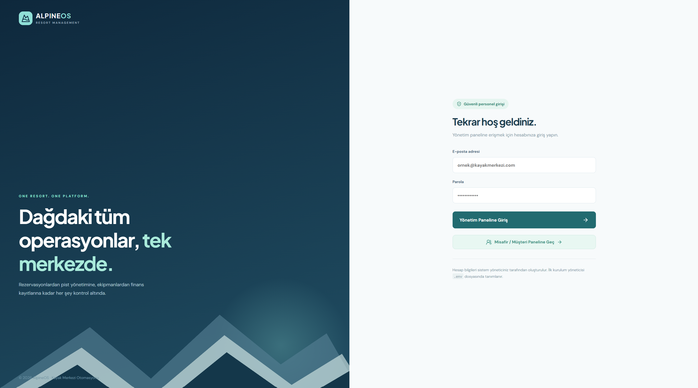 | 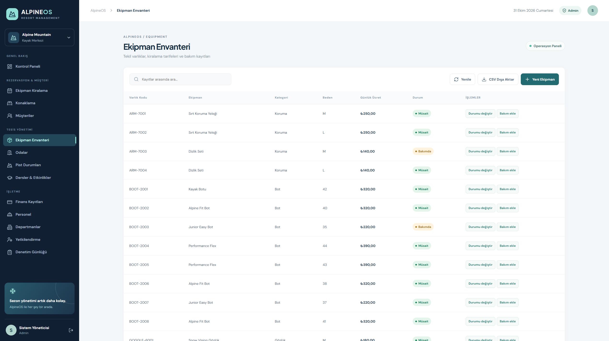 |
| **01.** Yönetici hesabıyla güvenli giriş | **03.** Ekipman kategorileri, demirbaşlar ve stok durumu |

| Kiralama yönetimi | Konaklama yönetimi |
|:--:|:--:|
| 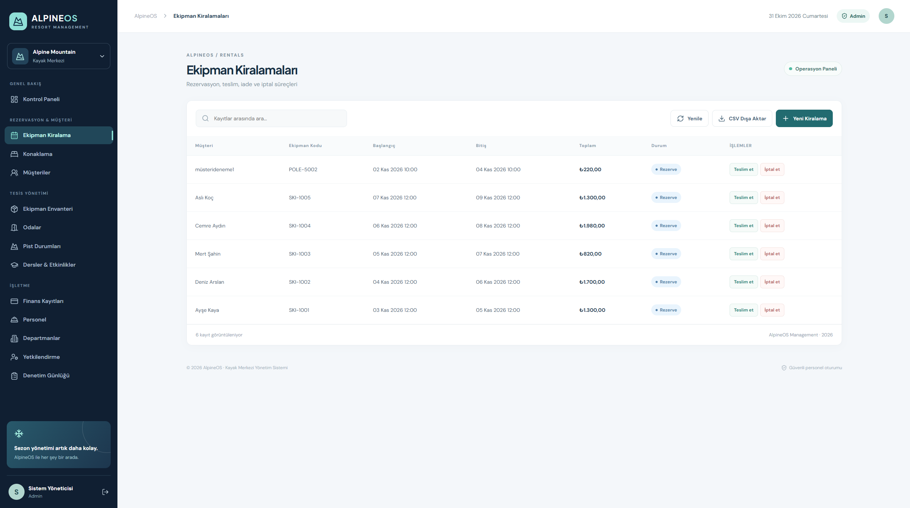 | 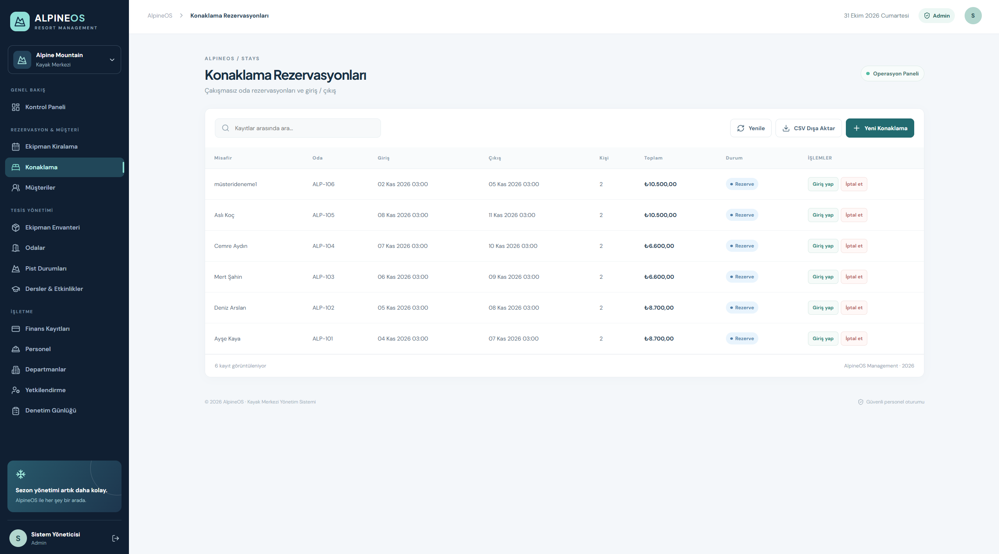 |
| **04.** Kiralama kayıtları ve işlem durumları | **05.** Oda bilgileri ve konaklama rezervasyonları |

| Pist durumları | Dersler ve etkinlikler |
|:--:|:--:|
| 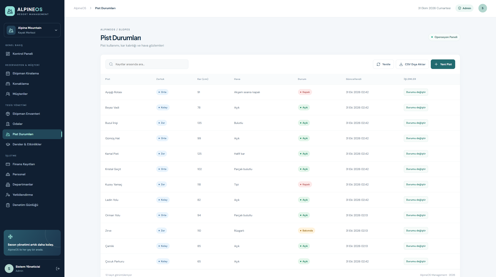 | 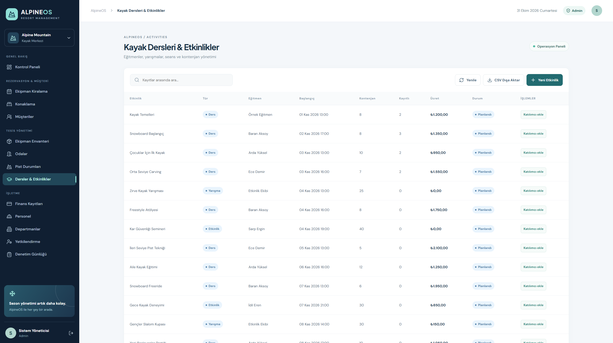 |
| **06.** Pist durumu, hava ve kar bilgileri | **07.** Ders programları, eğitmenler ve katılımlar |

| Finans kayıtları | Departman ve personel |
|:--:|:--:|
| 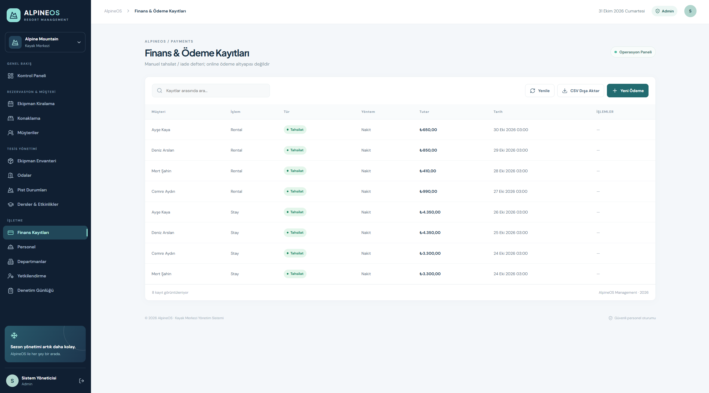 | 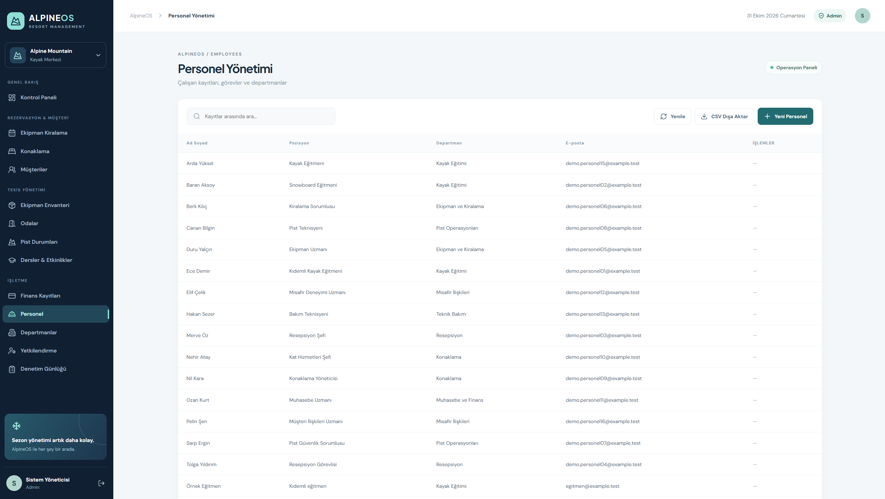 |
| **08.** Manuel tahsilat ve iade kayıtları | **09.** Organizasyon ve çalışan kayıtları |

> **02. Yönetici kontrol paneli** bölümün başındaki uygulama önizlemesinde gösterilmiştir.

### Müşteri arayüzü

| Müşteri girişi | Ekipman kataloğu |
|:--:|:--:|
| 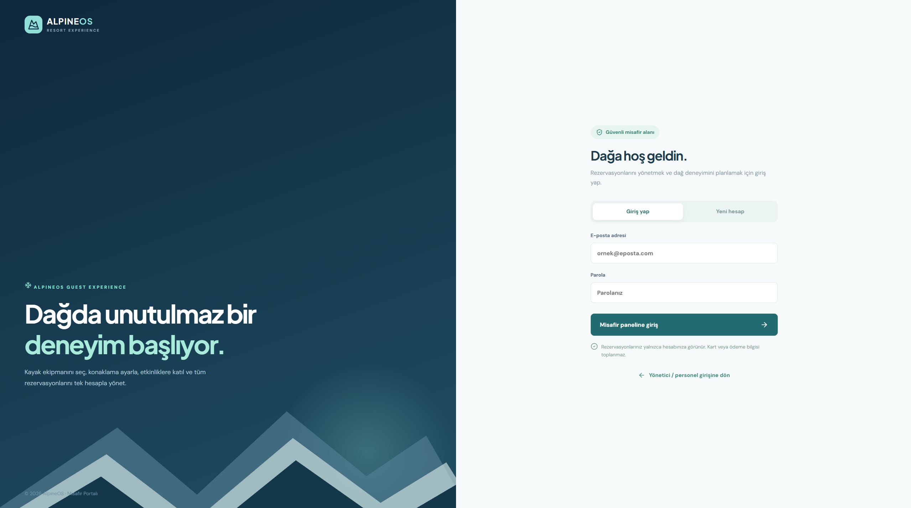 | 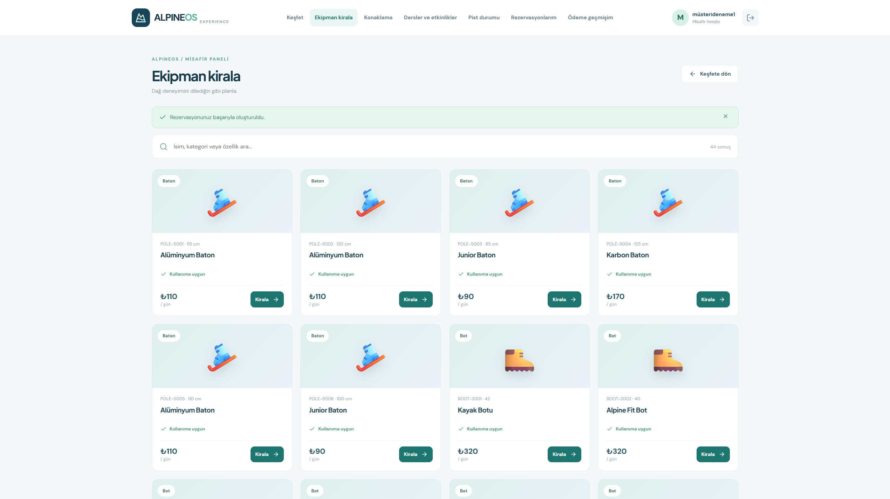 |
| **10.** Müşteriye özel oturum ve kayıt | **12.** Kiralanabilir ürünler ve fiyatları |

| Rezervasyon formu | Müşteri konaklama seçenekleri |
|:--:|:--:|
| 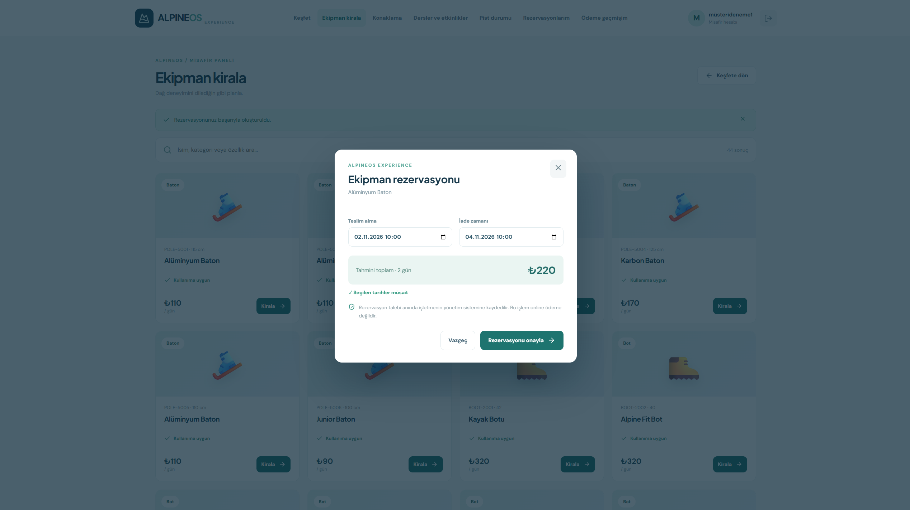 | 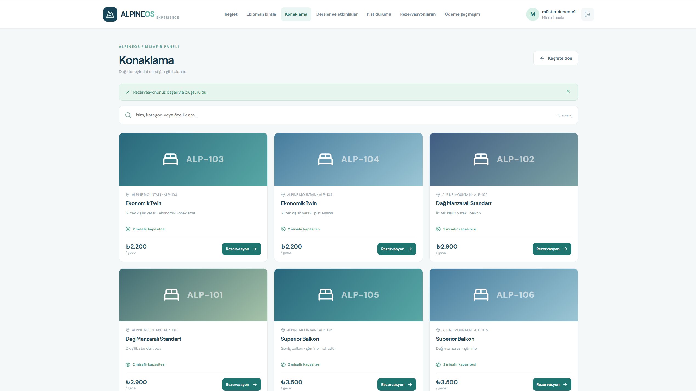 |
| **13.** Tarih, müsaitlik ve tutar bilgileri | **14.** Oda ve dağ evi seçenekleri |

| Rezervasyonlarım | Mobil müşteri deneyimi |
|:--:|:--:|
| 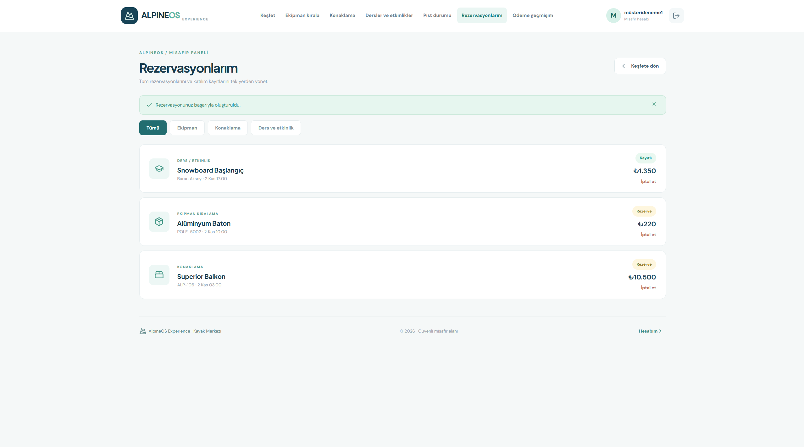 | 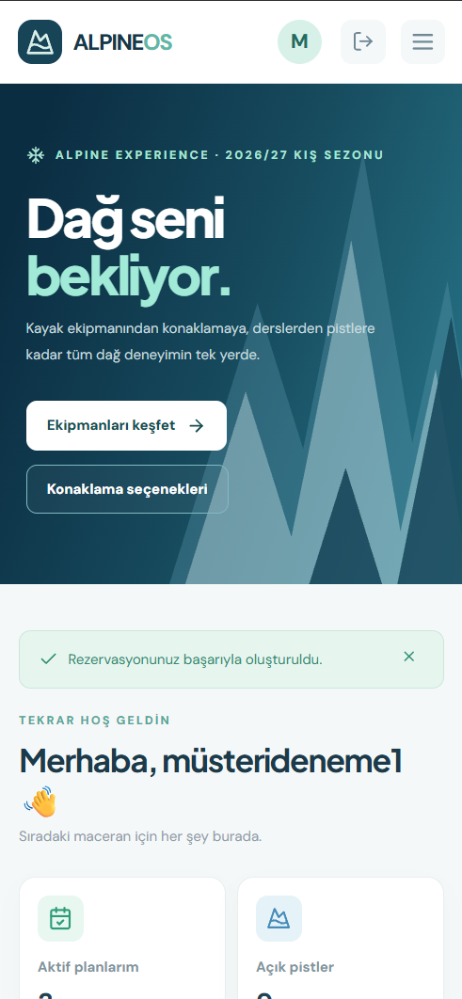 |
| **15.** Kiralama, konaklama ve etkinlik geçmişi | **16.** Dar ekranlara uyarlanmış müşteri arayüzü |

> **11. Müşteri keşfet sayfası** bölümün başındaki uygulama önizlemesinde gösterilmiştir. Böylece README'de **01–16 arasındaki tüm ekran görüntüleri** yer alır.

---

## Teknolojiler

| Katman | Teknoloji | Projedeki görevi |
|---|---|---|
| Backend | **C# · ASP.NET Core 10 Minimal API** | İş süreçleri ve HTTP endpointleri |
| Veri erişimi | **Entity Framework Core · Npgsql** | İlişkisel veri modeli ve veritabanı işlemleri |
| Veritabanı | **PostgreSQL 17** | Müşteri, ekipman, rezervasyon ve operasyon verileri |
| Frontend | **React 19 · TypeScript · Vite** | Yönetici ve müşteri kullanıcı deneyimleri |
| Arayüz | **CSS · Lucide Icons** | Duyarlı tasarım ve görsel bileşenler |
| Kimlik ve güvenlik | **ASP.NET Cookie Authentication · PasswordHasher · Antiforgery** | Oturum, parola ve istek güvenliği |
| Çalıştırma | **Docker · Docker Compose · Nginx** | Yerel dağıtım ve reverse proxy |
| Test / kalite | **xUnit · Python API testleri · GitHub Actions** | İş kuralı testleri ve kontrol altyapısı |

## Sistem mimarisi

Uygulama; React tabanlı iki kullanıcı deneyimi, ASP.NET Core API ve PostgreSQL veri katmanından oluşur. İstemci istekleri Nginx üzerinden API'ye iletilir. Kullanıcının rolü ve oturum kimliği kontrol edildikten sonra ilgili işlem veritabanına uygulanır.

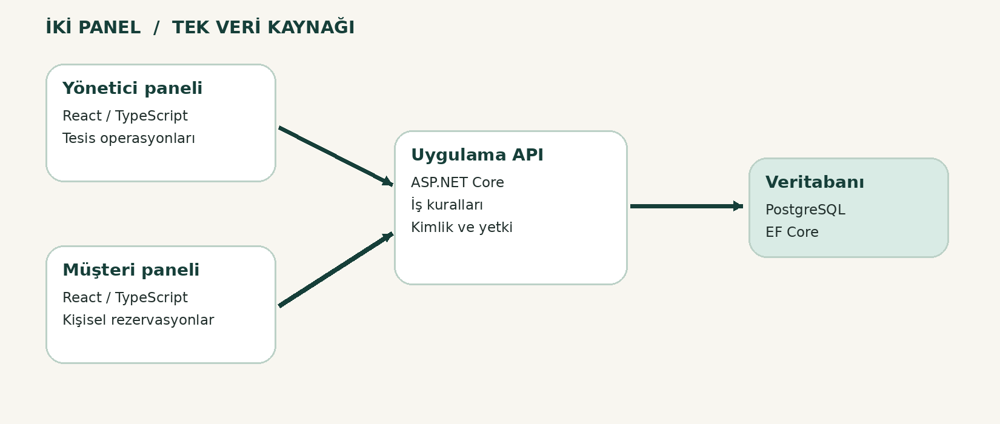

### Veri modeli

Müşteri, personel, ekipman, kiralama, oda, konaklama, pist, ders/etkinlik ve ödeme kayıtları ilişkisel olarak modellenmiştir.

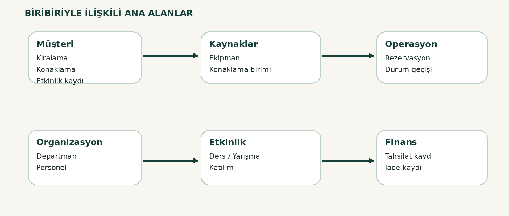

### Rezervasyon akışı

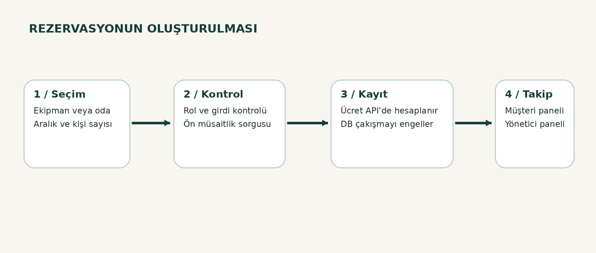

- Rezervasyon öncesinde uygunluk bilgisi kullanıcıya gösterilir.
- İşlem kaydedilirken sunucu kuralları yeniden doğrulanır.
- PostgreSQL tarafındaki çakışma kısıtları, uygun aralıklar için aynı ekipman veya odanın iki kez rezerve edilmesini önlemeye yardımcı olur.
- Konaklama kapasitesi ve etkinlik kontenjanı sunucu tarafında kontrol edilir.
- Müşterinin kendi rezervasyonu yönetici arayüzündeki operasyon kayıtlarıyla aynı veritabanında tutulur.

> Mimari, API ve veri modeliyle ilgili ayrıntılar için [teknik doküman](docs/reports/02_Teknik_Mimari_Veri_Modeli.pdf) ve [mimari notları](docs/architecture.md) incelenebilir.

---

## Kurulum

### Gereksinimler

- **Docker Desktop** ve Docker Compose
- **Git** (depodan klonlamak için)
- İsteğe bağlı: Kaynak koduyla ayrı geliştirme için **.NET 10 SDK**, **Node.js 22+** ve **npm**

### Docker ile çalıştırma

Proje klasöründe PowerShell açın:

```powershell
# İlk kurulum: örnek ortam değişkenlerini oluştur
Copy-Item .env.example .env

# .env dosyasını düzenle
code .env
```

`.env` dosyasında `POSTGRES_PASSWORD`, `ADMIN_PASSWORD` ve `ADMIN_EMAIL` değerlerini kendinize göre ayarlayın. En az 12 karakterlik, güçlü ve birbirinden farklı parolalar kullanın. Gerçek `.env` dosyasını GitHub'a eklemeyin.

```powershell
# Uygulamayı derle ve başlat
docker compose up -d --build

# Servis durumunu kontrol et
docker compose ps
```

**Uygulama:** [http://localhost:8088](http://localhost:8088)

**Yönetici paneli:** `.env` içindeki `ADMIN_EMAIL` ve `ADMIN_PASSWORD` ile giriş yapın.

**Müşteri paneli:** Giriş ekranından **Misafir / Müşteri Paneline Geç** seçeneğini açın ve yeni müşteri hesabı oluşturun. Müşteri kayıt parolası en az 12 karakter olmalıdır.

`SEED_DEMO_DATA=true` yalnızca geliştirme ve tanıtım amaçlı örnek işletme kayıtları oluşturmak için kullanılmalıdır.

### Uygulamayı durdurma

```powershell
docker compose down
```

Bu komut veritabanı volume'unu silmez. **`docker compose down -v` komutunu mevcut verilerin bulunduğu ortamda kullanmayın; volume'ları ve içlerindeki verileri kaldırır.**

### Kaynak kodunu ayrı çalıştırma

Docker kullanmadan geliştirme yapmak isteyenler, erişilebilir bir PostgreSQL veritabanı ve uygun `ConnectionStrings__Resort`, `ADMIN_EMAIL`, `ADMIN_PASSWORD` ayarları sağladıktan sonra API ile arayüzü ayrı terminalde başlatabilir:

```powershell
cd api
dotnet restore
dotnet run --launch-profile http
```

```powershell
cd web
npm install
npm run dev
```

Vite geliştirme arayüzü varsayılan olarak `http://localhost:5173`, API ise `http://localhost:5107` adresini kullanır.

---

## Proje klasörleri

```text
SkiResort-Management/
├── api/                       # ASP.NET Core API, modeller ve iş kuralları
├── web/                       # React yönetici ve müşteri panelleri
├── tests/                     # .NET iş kuralı testleri
├── scripts/                   # Kurulum, yedek ve API test betikleri
├── docs/
│   ├── screenshots/           # README'deki 16 gerçek uygulama görüntüsü
│   ├── diagrams/              # Mimari, veri modeli ve iş akışı çizimleri
│   ├── reports/               # Proje raporları ve sunum PDF'leri
│   ├── architecture.md
│   ├── api-reference.md
│   ├── customer-portal.md
│   └── testing.md
├── compose.yaml               # Docker servisleri
├── .env.example               # Örnek ortam değişkenleri
├── README.md                  # Bu dosya
├── SECURITY.md
└── LICENSE
```

## Test ve kalite kontrolleri

Projeyi kendi bilgisayarımda Docker ile çalıştırıp yönetici ve müşteri ekranlarını kontrol ettim. Kaynak kodunda ayrıca iş kurallarına yönelik xUnit testleri, temel API kontrolleri ve müşteri erişim senaryoları için test betikleri bulunuyor. **Tüm otomatik testlerin eksiksiz geçtiğine veya sistemin canlı ortam için denetlendiğine ilişkin bir iddiada bulunmuyorum.**

```powershell
# .NET SDK ile iş kuralı testleri
dotnet test tests/SkiResort.Tests/SkiResort.Tests.csproj

# Frontend derlemesi
cd web
npm install
npm run build
cd ..

# Çalışan servisleri incele
docker compose ps
```

API test betikleri ve dikkat edilmesi gereken veri senaryoları için [test dokümanına](docs/testing.md) ve [kalite notlarına](docs/reports/04_Test_Kalite_Notlari.pdf) bakılabilir.

### Güvenlik ve sınırlar

- Yönetici/personel ve müşteri hesapları için ayrı rol kontrolleri vardır.
- Parolalar hash'lenir; oturumlar HTTP-only cookie üzerinden yönetilir.
- Form/API değişiklik isteklerinde CSRF koruması uygulanır.
- Müşteri portalında başka müşterilerin kayıtlarını doğrudan sorgulamak için istemci tarafından müşteri kimliği seçilemez.
- **Gerçek kredi kartı tahsilatı yapılmaz.** Finans modülü manuel kayıt ve iade hareketlerini takip eder.
- İlk veritabanı kurulumu `EnsureCreatedAsync()` yaklaşımını kullanır. Üretim yayını öncesinde migration stratejisi ve veri aktarımı ayrıca planlanmalıdır.
- İnternete açılmadan önce HTTPS, yetki kontrolü, KVKK süreçleri, yedekleme, otomatik test ve dağıtım güvenliği tamamlanmalıdır.

Ayrıntılar: [SECURITY.md](SECURITY.md) · [Operasyon notları](docs/operations.md)

---

## Proje dokümanları

Bu depo, kaynak kodla birlikte akademik ve teknik açıdan projeyi açıklayan belgeleri de içerir.

| Doküman | İçerik |
|---|---|
| [Akademik proje raporu](docs/reports/01_Proje_Raporu.pdf) | Projenin problemi, kapsamı, geliştirme yaklaşımı ve değerlendirme |
| [Teknik mimari ve veri modeli](docs/reports/02_Teknik_Mimari_Veri_Modeli.pdf) | Katmanlar, ilişkiler, veri bütünlüğü ve iş akışları |
| [Yönetici ve müşteri kullanım kılavuzu](docs/reports/03_Kullanim_Kilavuzu.pdf) | İki panelin temel kullanıcı senaryoları |
| [Test ve kalite notları](docs/reports/04_Test_Kalite_Notlari.pdf) | Kontrol edilen alanlar, sınırlamalar ve iyileştirme önerileri |
| [Ekran görüntüsü rehberi](docs/reports/05_Ekran_Goruntusu_Rehberi.pdf) | Uygulama ekranlarının belgelenmesi |
| [Proje sunumu](docs/reports/06_Proje_Sunumu.pdf) | Sistemin genel tanıtımı, mimarisi ve modülleri |
| [API referansı](docs/api-reference.md) | Sunucudaki endpointlerin açıklamaları |
| [Müşteri paneli dokümanı](docs/customer-portal.md) | Müşteri deneyimi ve iki panelin bağlantısı |

## Üniversite projesiyle ilişkisi

Bu çalışmanın çıkış noktası, üniversitede geliştirdiğim **Kayak Merkezi Otomasyonu** projesidir. İlk çalışmadaki veritabanı ve işletme süreçleri fikrini korudum; ancak uygulamayı güncel web teknolojileriyle **yeniden tasarladım ve geliştirdim**. AlpineOS, eski projenin kaynak kodlarının birebir taşınmış hali değil, aynı konu temelinde oluşturduğum genişletilmiş bir yazılım projesidir.

Bu süreçte ilişkisel veritabanı tasarımı, backend–frontend entegrasyonu, rol tabanlı erişim, rezervasyon iş kuralları ve konteyner tabanlı kurulum üzerine çalıştım.

## English summary

**AlpineOS** is a full-stack modernization of my university ski resort automation project. It brings together administrative operations and a customer-facing portal for equipment rentals, accommodation bookings, ski lessons, slope information, and reservation tracking. The application uses ASP.NET Core, React, TypeScript, PostgreSQL, and Docker Compose. It is a portfolio/educational project, not a production-certified reservation or payment service.

---

**Lisans:** MIT — [LICENSE](LICENSE)
