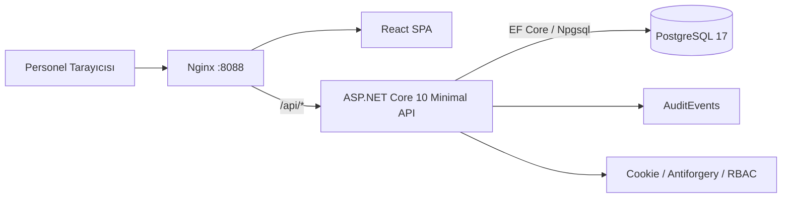
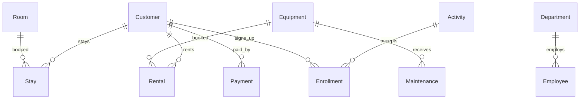
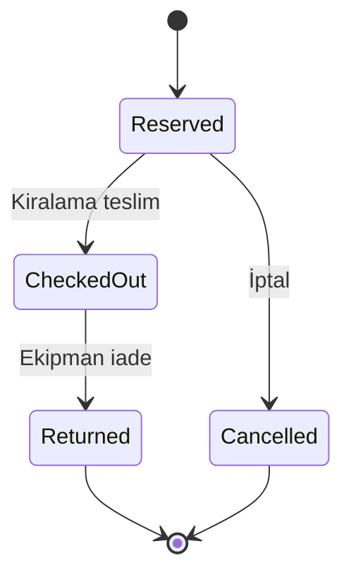

# Mimari ve tasarım kararları

## Bileşen diyagramı



Bu ilk sürüm **modüler tek servis** olarak tasarlandı; erken mikroservis bölünmesi yoktur. `api/Features` iş akışlarına göre modüllere ayrılır. `Models` veri varlıklarını, `Services/Rules` saf alan kurallarını, `Security` kimlik süreçlerini içerir.

## Temel veri modeli



### Rezervasyon aralıkları

`[StartAt, EndAt)` tanımı: önceki rezervasyon tam 10:00'da biterse sonraki 10:00'da başlayabilir. Hem API'de önce kontrol yapılır, hem veritabanında PostgreSQL `EXCLUDE USING gist` kısıtıyla yarış koşullarında ikinci rezervasyonun yazılması engellenir.

```sql
CREATE EXTENSION IF NOT EXISTS btree_gist;
ALTER TABLE "Rentals" ADD CONSTRAINT no_overlapping_active_rentals
  EXCLUDE USING gist
    ("EquipmentId" WITH =, tstzrange("StartAt", "EndAt", '[)') WITH &&)
  WHERE ("Status" IN ('Reserved','CheckedOut'));
```

`Stays` için de aynı desen uygulanır; etkin durumlar `Reserved`, `CheckedIn`. API geçersiz / çakışan taleplere 400/409 döndürür. **Uygulama düzeyinde ilk kontrol tek başına güvenlik sağlamaz; son söz veritabanınındır.**

### Ücret kuralları

- Ekipman: `DailyRate * ceil((EndAt - StartAt).TotalDays)`. Kısmi gün bir gün ücretlendirilir. Para `numeric(12,2)`.
- Konaklama: `NightlyRate * gece sayısı`. Konaklama API'si UTC gün sınırları kullanır (tarih string'i `YYYY-MM-DDT00:00:00Z`). Yerel tesis gün/saat politikası bir sonraki sürüm için özelleştirilecektir.
- UI tutar göndermez; API ekipmanın/odanın güncel tarifesiyle hesaplar ve rezervasyona sabitler.
- Finans hareketleri `Charge` ve `Refund`, bakiye `Charge - Refund`. Kısmi ödemeye izin verilir. Seri hale getirilebilir transaction seçilmiş; aynı anda ödeme yarışında bir işlemin 409 alması beklenir.

### Durum geçişleri



Konaklama `Reserved → CheckedIn → Completed` veya `Reserved → Cancelled`.

## Kimlik, oturum ve güvenlik

- Hesaplar `StaffAccount` tablosunda kayıtlı, parola ASP.NET `PasswordHasher` ile hash'lenir.
- 5 başarısız girişte 15 dakika kilit, ayrıca giriş endpointinde pencere başına 8 istek sınırı.
- Cookie HTTP-only ve SameSite Strict; HTTPS production modu için Secure.
- Her durum değiştiren API metodu CSRF başlığı gerektirir. Frontend `/api/auth/csrf` ile token alır; giriş sonrasında token yeniler.
- Roller `Admin, Reception, Equipment, Slope, Cashier`; sunucu endpointleri rol bazında sınırlar. **Bu sürümde listeleme düzeyi okumalar daha geniştir**; gerçek müşteri verisiyle çalışmadan önce ince taneli yetkilendirme tamamlanmalıdır.
- Denetim kaydında işlem türü, kullanıcı e-postası ve referans vardır. Hassas metinler denetim detaylarına gereksiz yere eklenmemelidir.

## Bilinen teknik borçlar

1. EF migration geçmişi yok; `EnsureCreated` yalnız ilk kurulum için. Migration'a geçiş için temiz şema ve planlı data migration gerekir.
2. Yük testleri, gerçek PostgreSQL entegrasyon testleri ve tarayıcı E2E testleri henüz çalıştırılmadı.
3. `Dashboard` şimdilik hesaplama için tabloları belleğe çeker; büyük veri için SQL aggregasyonları / materialized view gerekir.
4. Depozito, ceza, gecikme, hasar ve bakım nedeniyle gelecekteki rezervasyonların yeniden tahsisi henüz uygulanmadı.
5. Ödeme modülü **yalnızca manuel kayıt**; gerçek kart tahsilatı, fatura, muhasebe defteri mevzuatı yerine geçmez.
6. Hesap devre dışı bırakma ve güvenlik damgasıyla oturumu anında iptal etme gibi ileri yetkiler yok.
7. Çoklu kayak merkezi/tesis için tenant izolasyonu bulunmaz.
