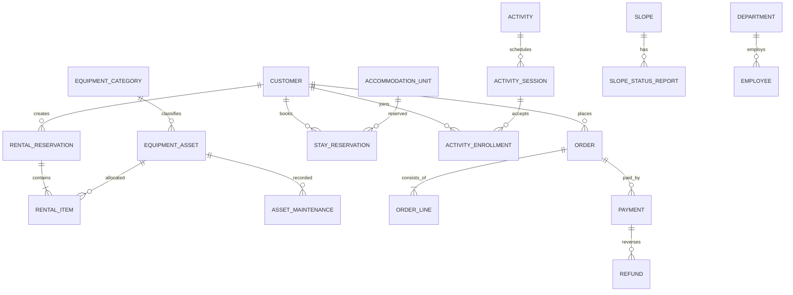

# 04 — İlk Mantıksal Veri Modeli

> Bu, `.accdb` dosyasının olduğu gibi yeniden çizimi değil, daha tutarlı bir yeni veri modelidir. Kesin tablo şeması API sözleşmeleri ve migration'larla geliştirilecektir.

## Ana tablolar

| Alan | Tablolar | Amaç |
|---|---|---|
| Kimlik | `users`, `roles`, `user_roles`, `permissions`, `role_permissions` | Güvenli giriş ve yetki |
| Organizasyon | `departments`, `employees` | Personel ve ekip |
| Müşteri | `customers` | Misafir bilgileri |
| Ekipman | `equipment_categories`, `equipment_assets`, `asset_maintenance`, `inventory_movements` | Tekil demirbaş/seri numarası, stok ve bakım |
| Kiralama | `rental_reservations`, `rental_items`, `rental_handover_events` | Sözleşme, birden fazla ekipman, teslim/iade |
| Konaklama | `accommodation_units`, `stay_reservations`, `stay_guests` | Oda/ev kapasitesi, tarih çakışması, konaklayanlar |
| Pist | `slopes`, `slope_status_reports` | Durum değişikliklerinin geçmişi |
| Ders ve etkinlik | `activities`, `activity_sessions`, `activity_enrollments` | Zaman, eğitmen, katılımcı ve kontenjan |
| Finans | `orders`, `order_lines`, `payments`, `refunds`, `invoice_records` | Sipariş, ödeme, iadeler, belge referansları |
| İzlenebilirlik | `audit_logs`, `outbox_messages` | Güvenilir işlem/günlük/bildirim altyapısı |

## Ana ilişkiler

## Kısıt ve zaman tasarımı

- Tüm zamanlar UTC `timestamptz` tutulur; gösterim tesisin `Europe/Istanbul` zaman dilimine dönüştürülür.
- Para tutarları için `numeric(12,2)` ve para birimi (`TRY`, `EUR`, ...); `float` kullanma.
- Kiralama ve konaklama zaman aralığı `[start, end)` olarak modellenir.
- Birim bazlı rezervasyonlarda, aktif durumlar için PostgreSQL exclusion constraint (`btree_gist` ve `tstzrange`) ile çakışmalar önlenebilir; aynı işlemde concurrency testleri yazılmalıdır.
- Ekipman kategorisine ait toplam stok, fiziksel demirbaşlar ve stok hareketleriyle tutarlı olmalıdır. `quantity` gereken sarf ürünleri için ayrı stok modeli kullanılır.
- İndeksler: rezervasyon durum/tarih, müşteri FK, ödeme sipariş FK, envanter seri numarası uniqueness.
- Hassas veriler için minimum veri, maskeleme, erişim ve saklama ilkeleri.

## Eski → yeni eşlemesi

| Eski tablo / görsel | Yeni karşılık |
|---|---|
| `Kullanıcılar` | `customers`, gerekiyorsa ayrı `users` |
| `KiralıkEkipmanlar` | `equipment_categories` + `equipment_assets` |
| `KiralamaGeçmişi` | `rental_reservations` + `rental_items` / `stay_reservations` |
| `İptalEdilenKiralar` | `status`, `cancellation_reason`, `audit_logs` |
| `Konaklama` | `accommodation_units` + `stay_reservations` |
| `Ödemeler` | `orders` + `payments` + `refunds` |
| `Departmanlar` / `Personel` | `departments` / `employees` |
| `PistDurumu` | `slopes` + `slope_status_reports` |
| `Etkinlikler` ve farklı görseldeki `Dersler` | `activities` + `activity_sessions` + `activity_enrollments` |
